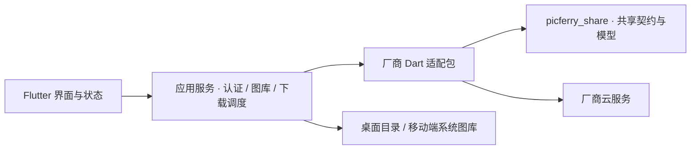

PicFerry 以 Flutter 应用作为用户入口，通过 Dart 厂商包连接云服务，再保存到桌面目录或移动端系统图库。下列分层描述的是代码职责，**不是三个公开源码仓库的声明**。网站仓库公开可访问，GUI/Core 的访问与发布核实结果见 [状态页](/status/)。

| 层 | 组件 | 职责 |
| --- | --- | --- |
| 界面与状态 | `picferry_gui/lib/screens`、`widgets`、`providers` | 账号入口、图库浏览、任务状态、中英文、主题与图库密度 |
| 应用服务 | `picferry_gui/lib/services` | 编排认证、图库查询与缓存、下载调度、取消及平台保存 |
| 厂商适配 | `picferry_core/packages/*_photos_downloader` | 厂商认证、媒体与资源解析、下载及各自支持的云端删除；同时包含库与 CLI 入口 |
| 共享契约 | `picferry_core/packages/picferry_share` | `CloudDownloader`、共享模型与下载参数等公共抽象 |
| 平台保存 | 桌面目录服务与 Android/iOS/OHOS 原生桥接 | 处理文件落盘或系统图库权限、保存请求及回执 |
| 文档 | `picferry-website` | 用户指南、能力矩阵、获取状态与安全说明 |

## 调用与能力边界

GUI 通过相对路径依赖直接调用 Dart 库，日常使用无需启动厂商 CLI，也不经过 Rust FFI。厂商实现围绕共享契约提供能力，但认证和删除规则保留厂商差异：GUI 当前只开放 iCloud、小米、vivo 新增账号，其他厂商 Core 有真实复制下载实现。完整差异集中维护在 [状态页](/status/)。

原生应用由本机直接访问厂商服务，当前未见 PicFerry 自有中转；Web 使用预览用的替代服务，仅展示 UI，不提供真实云服务连接。平台分支的存在不等于原生工程齐备，例如 macOS 有 Dart 分支但没有当前可用的 `macos/` 工程。

## 下载到系统保存

1. 界面提交账号和下载参数，应用服务协调厂商资源获取与任务进度。
2. 桌面将媒体保存到本地目录；移动端通过平台保存层写入系统图库。iOS 要求完整照片访问权限；OHOS 需要前台系统确认，每批最多 100 项。
3. 默认 `copy` 保留云端原件。选择 `move` 时，厂商资源校验及移动端保存成功回执共同约束后续云端删除；vivo 还受 suite 会话能力限制。
4. 图库显式删除走独立操作流程，不要求先下载或备份。取消任务保留已保存媒体，也不能撤回已经提交的云端删除。

账号配置、Cookie/会话、预览和元数据缓存属于不同的本地数据。移除账号只处理账号配置，不等于统一清理或撤销会话；这些数据也没有统一加密保证，详见 [安全](/security/)。

## 工程与文档协作

Core 使用 Melos 管理包；GUI/Core 并排放置以满足路径依赖。标准 Flutter 工作区与 OHOS 隔离副本分别维护依赖、锁文件及产物，具体命令见 [从源码构建](/install/)。

网站的公开讨论与文档 PR 使用 [picferry/picferry-website](https://github.com/picferry/picferry-website)。GUI/Core 实现贡献需先获得相应源码访问权限，见 [贡献](/contributing/)。
