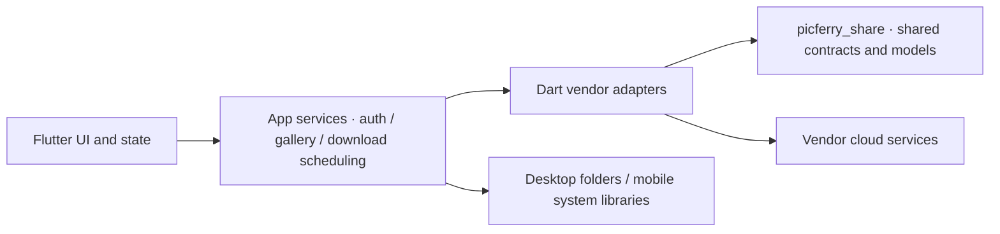

PicFerry uses a Flutter app as the user interface, connects to cloud services through Dart vendor packages, and saves media to desktop folders or mobile system libraries. The layers below describe code responsibilities, **not three publicly accessible source repositories**. The website repository is public; see [Status](/en/status/) for GUI/Core access and release checks.

| Layer | Component | Responsibility |
| --- | --- | --- |
| UI and state | `picferry_gui/lib/screens`, `widgets`, `providers` | Account entry points, gallery browsing, task state, Chinese/English, themes, and gallery density |
| App services | `picferry_gui/lib/services` | Coordinate authentication, gallery queries and caching, download scheduling, cancellation, and platform saving |
| Vendor adapters | `picferry_core/packages/*_photos_downloader` | Vendor authentication, media/resource parsing, downloads, and supported cloud deletion; includes library and CLI entry points |
| Shared contracts | `picferry_core/packages/picferry_share` | Common abstractions such as `CloudDownloader`, shared models, and download parameters |
| Platform saving | Desktop folder services and Android/iOS/OHOS native bridges | File writes or system-library permissions, save requests, and receipts |
| Documentation | `picferry-website` | User guides, capability matrices, availability, and security guidance |

## Calls and capability boundaries

The GUI calls Dart libraries directly through relative path dependencies. Everyday use does not require launching a vendor CLI or using a Rust FFI bridge. Vendor implementations follow shared contracts but retain their authentication and deletion rules. The GUI currently enables adding iCloud, Xiaomi, and vivo accounts; Core has real copy-download implementations for the other vendors. The [Status page](/en/status/) centralizes the full differences.

Native apps access vendor services directly from the local device, with no PicFerry-operated relay observed in the current implementation. Web uses preview substitutes to display the UI without real cloud-service connections. A platform code branch does not imply a complete native project: macOS has Dart branches but currently lacks a native `macos/` project.

## From downloading to system saving

1. The UI submits the account and download parameters; app services coordinate vendor resource retrieval and task progress.
2. Desktops save media to local folders, while mobile platforms write through the platform saving layer to the system library. iOS requires full photo-library access; OHOS requires foreground system confirmation, with at most 100 items per batch.
3. Default `copy` keeps cloud originals. For `move`, vendor resource verification and successful mobile save receipts gate subsequent cloud deletion. vivo additionally requires suite-session capabilities.
4. Explicit gallery deletion follows a separate flow with no prior download or backup requirement. Canceling a task keeps saved media and cannot withdraw cloud deletions already submitted.

Account configuration, Cookie/session files, and preview/metadata caches are distinct local data. Removing an account only handles its configuration, not complete cleanup or session revocation. There is no uniform encryption guarantee for these data; see [Security](/en/security/).

## Engineering and documentation collaboration

Core uses Melos for package management. GUI/Core are arranged as siblings to satisfy path dependencies. The standard Flutter workspace and isolated OHOS copies maintain separate dependencies, lockfiles, and artifacts; see [Build from source](/en/install/) for commands.

Use [picferry/picferry-website](https://github.com/picferry/picferry-website) for public website discussion and documentation PRs. Implementation contributions to GUI/Core require the corresponding source access first; see [Contributing](/en/contributing/).
